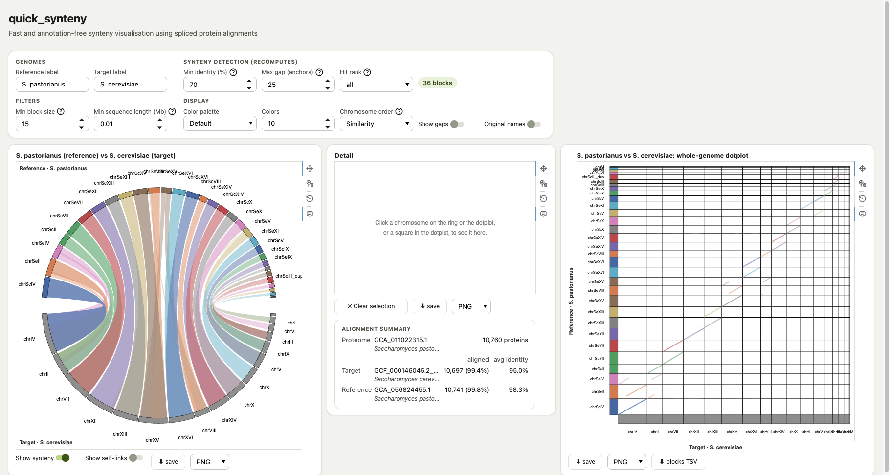

# quick_synteny

quick_synteny plots synteny between two genome assemblies. It aligns one
proteome to both genomes with [miniprot](https://github.com/lh3/miniprot),
so neither genome needs an annotation, and chains the matches into
syntenic blocks. Give it your genome and a taxid, and it finds a reference
genome and proteome on NCBI; or give it your own. The result is a single
self-contained HTML page: a Circos-style ring, a detail panel and a
whole-genome dotplot, all interactive, working offline, and exportable as
SVG, PNG or JPEG.



*S. cerevisiae* (target) against the hybrid *S. pastorianus* (reference),
chromosomes in Similarity order: both its *S. cerevisiae*-like (`chrSc…`)
and *S. eubayanus*-like (`chrSe…`) chromosomes line up against
*S. cerevisiae*.

**Contents:** [Running it](#running-it) ·
[Quick start](#quick-start) · [How it works](#how-it-works) ·
[The result page](#the-result-page) · [Outputs](#outputs) ·
[Parameters](#parameters) · [Polyploid genomes](#polyploid-genomes) ·
[Large genomes](#large-genomes-chunked-alignment) ·
[Profiles](#profiles) · [Development](#development)

## Running it

There are two ways to run quick_synteny:

- **The desktop app** (macOS and Linux). Fill in a form, and it runs the
  pipeline on your computer, shows each step as it runs and opens the
  result. It needs nothing preinstalled: it installs its own Nextflow and
  Java on first launch, and builds each tool as a conda environment. Docker
  is optional. The app is unsigned, so macOS asks you to allow it once per
  install. Download it from the
  [releases](https://github.com/gbdias/quick_synteny/releases), and see
  [gui/README.md](gui/README.md) for details.
- **The command line**, with [Nextflow](https://www.nextflow.io) 25.10 or
  newer and Docker, conda or Apptainer/Singularity (see
  [Profiles](#profiles)). This is also the way to run on a SLURM cluster.

## Quick start

```bash
# find a reference genome and proteome on NCBI, starting from your species
nextflow run main.nf -profile standard \
  --taxid 562 --assembly target_genome.fa --outdir results

# use your own reference genome and proteome (no NCBI at all)
nextflow run main.nf -profile standard \
  --assembly target_genome.fa \
  --reference reference_genome.fa --proteome proteome.faa \
  --outdir results

# pick the reference on NCBI yourself: a taxon (its best chromosome-level
# assembly) or an exact assembly; the proteome is still found for you
nextflow run main.nf -profile standard \
  --taxid 4932 --assembly target_genome.fa \
  --reference_taxid 27291 --outdir results
nextflow run main.nf -profile standard \
  --taxid 4932 --assembly target_genome.fa \
  --reference_accession GCA_056824455.1 --outdir results

# on a SLURM cluster (Apptainer/Singularity)
nextflow run main.nf -profile slurm \
  --taxid 562 --assembly target_genome.fa --outdir results
```

Open `results/synteny/target.reference.synteny.interactive.html` in any
browser.

## How it works


### 1. Finding a reference and proteome

When you give a `--taxid` but no reference, quick_synteny looks one up on
NCBI:

- It climbs your genome's lineage, from its species up to `--max_rank`
  (default: order), including the unranked clades in between, and queries
  NCBI's assemblies at each taxon. It stops at the **first taxon with a
  chromosome-level or complete assembly**.
- Within that taxon, the chromosome-level and complete assemblies are
  ranked by **contig N50**, then **scaffold N50**. The first one is the
  reference. Scaffold- and contig-level assemblies are never used as a
  reference.
- An assembly of your own species is only used if it's chromosome-level or
  better (a second assembly of the same organism is a legitimate
  reference). `--exclude_target` rules out your own species entirely.
- A taxon with more than 1000 assemblies is narrowed to NCBI's designated
  reference genomes, one per species, before ranking.

The **proteome** comes from the same climb, this time over annotated
assemblies of any level, since only their proteins are used. They're
ranked by assembly level (chromosome and complete genome first, then
scaffold, then contig), then the same two N50s; annotation quality plays
no part. When the reference came from NCBI, its species' own annotation
comes first whenever it has one, even when that species joins your
lineage above where the climb stopped.

`--reference_taxid` (the best chromosome-level assembly of that taxon) or
`--reference_accession` (exactly that assembly) replace the reference
search; the proteome is still found as above. With your own `--reference`
and `--proteome`, nothing is looked up. Each run keeps the candidates and
the path of the search in `pipeline_info/` (see [Outputs](#outputs)), so
you can see what was passed over.

### 2. Aligning one proteome to both genomes

miniprot aligns the proteome to each genome, inferring each protein's
exon/intron structure directly on the assembly. It keeps each protein's
best hit and up to 5 alternatives scoring within 70% of it (`-N 5
--outs=0.7`).

`bin/extract_hits.py` turns each genome's alignments into a hit table and
groups overlapping hits into **loci**: hits that share coding exons form
one locus, so a gene's isoforms count once, while a gene nested inside
another's intron stays separate. A locus is a gene wherever the assembly
happens to be annotated, but it doesn't need to be. An **anchor** is one
protein's locus in each genome: the protein's positions in genome A and
genome B are the synteny signal itself, with no separate ortholog search.

### 3. Chaining anchors into blocks

`bin/chain.js` chains anchors MCScanX-style, counting in **loci rather
than base pairs**:

- Consecutive anchors in a block may skip at most `max_gap` anchors
  (default 25) on either genome.
- Along a block, anchors must be strictly increasing on both genomes (a
  `+` block) or increasing on one and decreasing on the other (a `−`
  block, an inversion).
- A block's score is its number of anchors (distinct loci on both
  genomes).

Counting in anchors lets one max gap work for an anchor-dense 120 Mb
genome and an anchor-sparse 30 Gb one. Two filters keep noise out:

- **Min identity** ignores weak hits. It uses miniprot's Positive score
  (identical or similar residues) rather than its stricter Identity, and
  starts at 70%. The page's alignment summary shows each genome's average
  best-hit identity, a guide for where to set it.
- **Min block size** drops short chains. It starts at 15 anchors; lower
  it (to 5, say) to see short blocks, such as those left by an ancient
  duplication. It can't go above the longest block, and returns to your
  value once a re-chain allows it. When no block is longer than 3 anchors
  (distant genomes, strict settings) it's fixed at 3 and greyed out, with
  a note saying why.

The exact rules are specified in the header of `bin/chain.js`.

**Chaining is tuned on the result page, not before the run.** The page
embeds both genomes' hit tables and re-chains in the browser, in a Web
Worker running the same `bin/chain.js`. Min identity, max gap, hit rank
and min block size all change live, so a run needs no chaining decisions,
and the desktop app doesn't ask for any. `--min_identity`, `--max_gap` and
`--min_block` only set the page's starting values. They're hidden from
`--help` (`--help --showHidden` lists them, `--help min_identity` shows
one).

**What this trades.** An earlier version used a separate ortholog search
(jcvi + LAST). Reusing the miniprot alignments instead cut the total
runtime on genome-scale *Arabidopsis* data from about 35–40 minutes to
2–3 minutes, and removed jcvi/LAST's emulation problems on Apple Silicon.
Expect more false positive and false negative blocks than a statistically
rigorous tool such as jcvi or MCScanX would give; speed and simplicity are
the deliberate goal.

## The result page

Each run produces one page, `synteny/target.reference.synteny.interactive.html`.
It's built with Bokeh, embedded in the page, so it needs no server or
internet connection.

### Panels

- **Ring:** both genomes around a Circos-style circle, the reference on the
  top half and the target on the bottom, with syntenic blocks as ribbons
  across the middle.
- **Detail:** one chromosome's links against the other genome, with the
  other side's chromosomes packed side by side. Click a chromosome (on the
  ring, or a dotplot axis) to show it here, or click a dotplot square to
  show that one chromosome pair, including pairs with no alignments.
- **Dotplot:** the whole genome as a target-by-reference grid, each block
  a diagonal segment (anti-diagonal for an inversion).

A small alignment summary under the detail panel shows the proteome's
size and origin, and each genome's aligned-protein count and mean
identity.

### Selecting

One selection shows in every panel. Click a chromosome (a ring wedge or a
dotplot axis band), a chromosome pair (a dotplot square) or a single block
(a ribbon or a dotplot segment). Everything belonging to it stays bright
(its ribbons and partner chromosomes, its dotplot row or column, the
block itself), everything else dims, and the detail panel shows the
chromosome or pair.

A selection survives re-chaining, filtering and reordering for as long as
it exists; a block that disappears falls back to its chromosome pair. A
self-link selects on the ring only. Clear the selection with **Clear
selection**, a click on empty ring space or a double-click on the ring. A
click on empty detail-panel space steps a selected block back out to its
pair.

### Controls

The page-wide controls sit above the panels in four groups:

- **Genomes:** the two genomes' names, by default their short species
  names (e.g. "D. melanogaster"), or their accessions when the species
  isn't known. They appear in every panel's titles, the ring's corner
  labels, the dotplot's axis titles and the detail panel's row labels, so
  an exported panel always says which genome is which.
- **Synteny detection:** min identity, max gap and hit rank. Changing these
  re-chains; a status pill shows the number of blocks.
- **Filters:** min block size, and min sequence length, which hides short
  chromosomes and scaffolds.
- **Display:** color palette, number of colors, chromosome order, gaps and
  original names.

Controls that act on one panel sit under it.

**Chromosome order** applies to the ring and both dotplot axes:

- **Size:** largest first (the default).
- **File order:** each genome's FASTA order.
- **Similarity:** chromosomes that share blocks are placed next to each
  other, so the dotplot lines up into a diagonal and the ring's ribbons
  untangle. This is most useful for a closely related pair with a roughly
  1:1 chromosome correspondence.

Both ring halves read left to right. The reference genome's dotplot axis
reads bottom to top, with the first chromosome of the chosen order at the
bottom.

**Show gaps** (off by default) marks assembly gaps, runs of N's of
`--min_asm_gap` bp or longer (default 100), on the ring and the detail
panel, and as thin dotted lines on the dotplot. Gaps come from the same
renamed sequences as the links, so their coordinates always match.

**Original names.** Sequences are shown under short names (`chr1`, `chrM`,
`scaf12`…). Original names switches every panel, tooltip and the blocks
download to each sequence's own FASTA ID.

### Colors

Only the **reference genome** is colored, one hue per chromosome from a
qualitative palette (a few curated palettes, cycling through 1–10
colors). The **target** is a flat grey, so the reference stands out. Each
link takes the color of the reference chromosome it connects to, with an
opacity that scales with its anchor count, so strong blocks read bolder
than weak ones. You can trace by eye which reference chromosome a ribbon
belongs to, and see at a glance which blocks are well supported.

Hover any wedge, band or ribbon for its coordinates, anchor count, mean
identity and anchor density.

### Exporting

Each panel has its own save button and format menu:

- **SVG:** a vector original; open it in Inkscape, Illustrator or similar
  to edit it or convert it to PDF.
- **PNG** or **JPEG:** ready to paste into a slide or document.

**blocks TSV** downloads the blocks currently on screen. Every export
records its settings:

- the TSV's first line, e.g. `# min_identity=0.7 max_gap=25 min_block=5 ...`,
  named after `bin/chain_blocks.mjs`'s flags, so it reads as the command
  that reproduces the file
- an SVG's `<desc>`
- every file name, e.g. `..._blocks_id70_gap25_min5.tsv`

File names also use the genome labels currently set.

## Outputs

Everything goes under `--outdir`. Files are named `target` (your genome)
and `reference`.

| file | what it holds |
|---|---|
| `synteny/target.reference.synteny.interactive.html` | the result page |
| `synteny/target.reference.links.tsv` | the blocks at the run's starting values, with the same settings line as the page's TSV, for use without a browser |
| `synteny/target.reference.slider_links.tsv` | the blocks at min block 5: those at any higher threshold are exactly these with a score at or above it |
| `synteny/{target,reference}.slider_homeolog_links.tsv` | each genome's self-links (see [Polyploid genomes](#polyploid-genomes)), at min block 5 |
| `synteny/{target,reference}.hits.tsv.gz` | each genome's hit table, the page's input |
| `synteny/target.reference.stats.json` | the alignment summary |
| `pipeline_info/reference_selection.json`, `proteome_selection.json` | what was picked, and from which taxon |
| `pipeline_info/reference_candidates.tsv`, `proteome_candidates.tsv` | every candidate: level, contig and scaffold N50, annotated, same species |
| `pipeline_info/reference_search_log.tsv`, `proteome_search_log.tsv` | each taxon queried, in order, and how many assemblies it had |
| `pipeline_info/lineage.tsv` | your genome's lineage, as climbed (and `reference_lineage.tsv` for `--reference_taxid`) |
| `pipeline_info/{target,reference}.rename_lookup.tsv` | short plot name ↔ original FASTA ID |
| `pipeline_info/{target,reference}.chrom.sizes`, `*.gaps.tsv` | sequence lengths and assembly gaps |
| `pipeline_info/execution_*` | Nextflow's report, timeline and trace |

The discovery files are only there when something was looked up on NCBI.

## Parameters

| parameter | what it does |
|---|---|
| `--assembly` | your genome (FASTA, may be gzipped) |
| `--taxid` | NCBI taxid of your genome's species; needed whenever anything is looked up on NCBI |
| `--reference`, `--proteome` | your own reference genome and proteome FASTA |
| `--reference_taxid` | use the best chromosome-level assembly of this taxon as the reference |
| `--reference_accession` | use exactly this assembly (`GCA_…` or `GCF_…`) as the reference |
| `--max_rank` | how far up the taxonomy to look (default: `order`) |
| `--exclude_target` | never pick a reference or proteome of your own species |
| `--min_seq_size` | leave sequences shorter than this out of the plot (default: 10000 bp; 0 keeps all) |
| `--min_asm_gap` | shortest run of N's shown as an assembly gap (default: 100 bp) |
| `--miniprot_chunk_gb`, `--miniprot_m` | lower miniprot's memory use (see [Large genomes](#large-genomes-chunked-alignment)) |
| `--outdir` | where the results go (default: `results`) |

Give at most one of `--reference`, `--reference_taxid` and
`--reference_accession`. `--taxid` is needed unless `--proteome` is given
along with one of them.

Every parameter is described in `nextflow_schema.json`.
`nextflow run main.nf --help` lists them all, grouped, and
`--help <parameter>` shows one in full (e.g. `--help max_rank`). Each run
checks its parameters before anything starts: types, ranges, allowed
values, input files that must exist, and unknown names, so a misspelled
`--max-rank` is an error rather than silently ignored.

Validation and help come from the
[nf-schema](https://github.com/nextflow-io/nf-schema) plugin, pinned in
`nextflow.config` (2.7.3, the last release for Nextflow 25.10). Nextflow
downloads it on the first run. On a machine without internet access, such
as some HPC nodes, install it once beforehand:

```bash
nextflow plugin install nf-schema@2.7.3
```

## Polyploid genomes

Every run also finds which of a genome's chromosomes are homeologous to
each other, for both genomes, with nothing to set. The same chaining runs
on each genome's hits against itself: a protein hitting chr9 *and* chr10
of the same genome already is the homeolog signal. So no ploidy needs to
be declared; it picks up whatever multiplicity is in the data. Each genome
is scanned on its own, and both ends of a homeolog link land in that
genome's half of the ring.

The page's **Show self-links** switch draws them on the ring. It's off by
default, and the page only computes them while it's on. Self-links have a
dashed outline over a fainter fill, so they stand apart from the
cross-genome synteny: the reference genome's in its chromosomes' colors,
the target's in dark grey. While the switch is on, the status pill also
counts the self-link blocks that pass min block size, or says there are
none.

**What the self-comparison shows.** On a genome with older whole-genome
duplications underneath the polyploidy you're asking about, the self-scan
finds those too. *Arabidopsis*, for example, keeps extensive triplicated
synteny from ancient duplications under the *thaliana* × *arenosa*
hybridization that formed *suecica*. That's the biology, not something
this tool corrects for. Telling this event's homeologs from older
paralogs would need Ks-based dating, which is out of scope. This was
checked on an *A. thaliana* target against an *A. suecica* reference.

## Large genomes: chunked alignment

miniprot's whole-genome index needs about 10 GB of RAM per Gb of genome.
When that won't fit, `--miniprot_chunk_gb` splits each genome into chunks
of about that many Gb, aligns the proteome against each in parallel and
merges the results. Given without a value it uses 1 Gb chunks. Each task
requests `chunk Gb × --miniprot_gb_per_gb + 4` GB, about 15 GB at the
default. Whole sequences are never split, so a chunk is never smaller than
its longest chromosome. `--miniprot_m` is the other lever: it indexes
fewer k-mers, at some cost to sensitivity.

Chunked results are **close to, but not identical to**, a whole-genome
run. miniprot decides per index which k-mers are too repetitive to seed
from and which candidate hits to keep, so a chunk sees a slightly
different picture than the whole genome does. On *C. elegans*:

- the best hit was identical for about 98% of proteins
- about 97% of synteny blocks matched
- about 7–10% of proteins differed somewhere in their hit set, mostly in weak hits, lower-ranked secondaries, tandem gene arrays and exact score ties
- the blocks that differed were all small (5–7 anchors)

Each mode is deterministic on its own.

So leave chunking off whenever the whole-genome index fits. It's also
cheaper: every chunk aligns the whole proteome, which cost about 4× the
CPU time on *C. elegans*. When it doesn't fit, use the largest chunk size
that does, since fewer chunks stay closer to whole-genome, and only
compare runs made at the same setting.

## Profiles

- `standard`: Docker, local executor (a laptop or CI).
- `conda`: no container engine. Conda environments are built from
  `envs/*.yml`, with the local executor. Needs conda, mamba or micromamba
  (for the latter, add a `-c` config with `conda.useMicromamba = true`).
  The desktop app uses this one.
- `slurm`: Apptainer/Singularity, SLURM executor (HPC). `--slurm_queue`
  and `--singularity_cache_dir` set the partition and a shared image
  cache.
- `test`: Docker, local executor, tiny resource caps.

`conda` pins the same tool versions as the images, but each machine
solves the environments itself, so dependencies and build strings can
differ from the images, and results can too. On an *S. cerevisiae* run,
every output matched the `standard` profile's byte for byte. Compare runs
made with the same profile.

In the container profiles, every process runs a Seqera Containers image
built for the host's architecture (linux/arm64 on Apple Silicon,
linux/amd64 otherwise). No `--platform` is forced and nothing runs
emulated. That matters beyond speed: node's Maglev compiler miscompiles
the chainer under x86-64 emulation, silently skewing its results.
`bin/chain_blocks.mjs` also disables Maglev, and fails (exit 3, retried)
on an impossible result, in case it ever does run emulated.

## Development

### Adding or changing a parameter

Edit both `nextflow.config`'s `params` block and `nextflow_schema.json`.
The schema drives `--help`, validation and the desktop app's form (its
tips, defaults and limits). `validateParams()` in `main.nf` adds the rules
the schema can't express, such as "at most one reference source".

Two tests guard this:

- The desktop app's unit tests (`gui/test/schema.test.js`) fail when the
  form's parameters or defaults differ from the schema.
- `tests/params.sh` checks validation and `--help`. It needs no data,
  only Nextflow, and the Pipeline CI workflow runs it.

### Updating a tool

Tool versions live in one place: `envs/*.yml`, one conda environment per
image (ncbi-datasets + unzip, python, miniprot, nodejs, bokeh). Each
process names its environment with an `env_<name>` label.
`conf/containers.config` maps each label to its four images: Docker and
Singularity (an HTTPS SIF download), each for linux/amd64 and
linux/arm64. That file is generated, not edited by hand:

```bash
tools/update_containers.py            # every environment
tools/update_containers.py miniprot   # just envs/miniprot.yml
```

It asks the public Wave API behind seqera.io/containers (no token needed)
for each image, waits for any that have to be built first, and rewrites
the config. The same package list always gives the same frozen image, so a
rerun only builds what changed. To update a tool, bump its version in
`envs/<name>.yml`, run the script, and commit both files. Runs themselves
never contact Wave: the image URLs are fixed in the repository.

### Repository layout

- `main.nf`, `nextflow.config`, `conf/`: the pipeline's entry point and
  profiles.
- `nextflow_schema.json`: every parameter, for validation, `--help` and
  the desktop app's form.
- `modules/local/`: one process (or small group of processes) per tool.
- `bin/`: the scripts those processes run. `chain.js` is the chainer, shared
  by the pipeline and the result page; `plot_synteny_interactive.py` builds
  the page.
- `envs/`, `tools/update_containers.py`: the tool environments, and the
  script that generates `conf/containers.config` from them.
- `tests/params.sh`: parameter validation and `--help` checks.
- `gui/`: the desktop app (see [gui/README.md](gui/README.md)).
- `assets/`: the images in this README.
- `legacy/`: the original script this pipeline replaces.

### History

quick_synteny started as `legacy/quick_synteny.sh`, a SLURM script that
needed a reference genome supplied by hand. This Nextflow DSL2 port added
the NCBI discovery of a reference and proteome, then replaced the
jcvi + LAST ortholog search with chaining on the miniprot alignments
themselves (see [What this trades](#3-chaining-anchors-into-blocks)).
