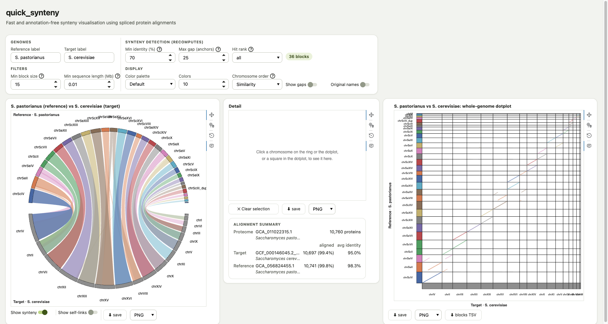

# quick_synteny

Plot synteny between two genome assemblies, with no annotation needed.
quick_synteny aligns one proteome to both genomes with
[miniprot](https://github.com/lh3/miniprot) and chains the matches into
syntenic blocks. Give it your genome and an NCBI taxid and it finds a
reference genome and proteome for you, or bring your own. The result is one
self-contained HTML page that works offline: a Circos-style ring, a detail
panel and a whole-genome dotplot.



*S. cerevisiae* (target) against the hybrid *S. pastorianus* (reference):
both its *S. cerevisiae*-like (`chrSc…`) and *S. eubayanus*-like (`chrSe…`)
chromosomes line up against *S. cerevisiae*.

## Running it

- **Desktop app** (macOS and Linux): fill in a form and it runs everything
  locally, installing its own Nextflow, Java and tools on first launch.
  Download it from the [releases](https://github.com/gbdias/quick_synteny/releases).
  It's unsigned, so macOS asks you to allow it once. See
  [gui/README.md](gui/README.md).
- **Command line**: [Nextflow](https://www.nextflow.io) 25.10 or newer, plus
  Docker, conda or Apptainer/Singularity (see [Profiles](#profiles)).

```bash
# find a reference genome and proteome on NCBI from your species' taxid
nextflow run main.nf -profile standard \
  --taxid 562 --assembly genome.fa --outdir results

# or bring your own reference and proteome (no NCBI lookup)
nextflow run main.nf -profile standard \
  --assembly genome.fa --reference reference.fa --proteome proteome.faa \
  --outdir results
```

Open `results/synteny/target.reference.synteny.interactive.html` in any browser.

## How it works


1. **Find a reference and proteome.** Starting from `--taxid`, it climbs your
   genome's lineage up to `--max_rank` (default: order) and takes the best
   chromosome-level assembly of the first taxon that has one. The proteome
   comes from the best annotated assembly found on the same climb.
   `pipeline_info/` records every candidate and each taxon searched.
2. **Align one proteome to both genomes** with miniprot. Hits that share
   coding exons form one *locus*, so isoforms count once. A protein's locus
   in each genome is an *anchor*, so no separate ortholog search is needed.
3. **Chain anchors into blocks**, MCScanX-style (`bin/chain.js`). A block's
   anchors run in the same order on both genomes (`+`) or in opposite order
   (`−`, an inversion), skipping at most `max_gap` loci between neighbours.
   Gaps are counted in loci, not base pairs, so one setting works for small
   and very large genomes. A block's score is its number of anchors.

<details>
<summary>How the reference and proteome are ranked</summary>

- Reference: only chromosome-level or complete assemblies, ranked by contig
  N50, then scaffold N50. An assembly of your own species is allowed;
  `--exclude_target` rules it out. A taxon with more than 1000 assemblies is
  narrowed to NCBI's reference genomes first.
- Proteome: annotated assemblies of any level, ranked by assembly level, then
  the same N50s. When the reference came from NCBI, its own species'
  annotation comes first.
- `--reference_taxid` or `--reference_accession` replace the reference
  search; the proteome is still found for you.

</details>

## The result page

Chaining is tuned on the page, not before the run. The page embeds both
genomes' hits and re-chains in your browser, so min identity, max gap, hit
rank and min block size update live. Every control has a help tip. Click a
chromosome, a chromosome pair or a block to highlight it in every panel.
Each panel exports SVG, PNG or JPEG, and **blocks TSV** saves the blocks on
screen; every export records the settings that made it.

## Outputs

| file under `--outdir` | contents |
|---|---|
| `synteny/target.reference.synteny.interactive.html` | the result page |
| `synteny/target.reference.links.tsv` | the blocks at the run's starting settings |
| `synteny/{target,reference}.hits.tsv.gz` | each genome's hit table |
| `pipeline_info/` | how the reference and proteome were chosen, original sequence names, Nextflow reports |

## Parameters

| parameter | what it does |
|---|---|
| `--assembly` | your genome (FASTA, may be gzipped) |
| `--taxid` | your species' NCBI taxid |
| `--reference`, `--proteome` | your own reference genome and proteome |
| `--reference_taxid` | use the best chromosome-level assembly of this taxon as the reference |
| `--reference_accession` | use exactly this assembly (`GCA_…`/`GCF_…`) as the reference |
| `--max_rank` | how far up the taxonomy to search (default: `order`) |
| `--outdir` | where results go (default: `results`) |

Give at most one reference source. `--taxid` can only be left out when you
give `--proteome` and a reference source. `nextflow run main.nf --help` lists
every parameter, and `--help <name>` explains one. On a machine without
internet, run `nextflow plugin install nf-schema@2.7.3` once first.

## Large genomes

miniprot needs about 10 GB of RAM per Gb of genome. If that doesn't fit,
`--miniprot_chunk_gb` aligns each genome in chunks (1 Gb if given no value).
Results are close to a whole-genome run but not identical (about 97% of
blocks matched on *C. elegans*), and chunking costs more CPU. Use it only
when needed, with the largest chunk that fits. `--miniprot_m` also lowers
memory, at some cost to sensitivity.

## Profiles

- `standard`: Docker, on this machine.
- `conda`: conda environments from `envs/*.yml`, no container engine (the
  desktop app uses this). Each machine solves the environments itself, so
  results can differ slightly from the container profiles; compare runs
  made with the same profile.
- `slurm`: Apptainer/Singularity on SLURM; `--slurm_queue` and
  `--singularity_cache_dir` set the partition and the image cache.
- `test`: Docker with tiny resource limits.
