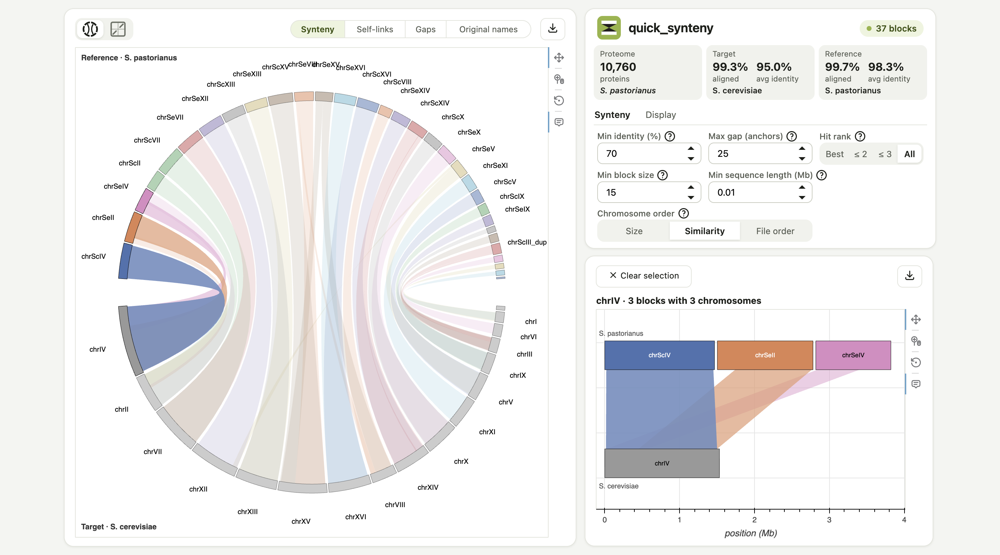

# quick_synteny

[](https://doi.org/10.5281/zenodo.24339745)

Plot synteny between two genome assemblies, with no annotation needed. The
result is one self-contained HTML page: a Circos-style ring, a detail panel
and a whole-genome dotplot.



*S. cerevisiae* against the hybrid *S. pastorianus*: both its
*S. cerevisiae*-like (`chrSc…`) and *S. eubayanus*-like (`chrSe…`)
chromosomes line up.

## What it's for

A quick look at large-scale synteny between genomes that are unannotated and
possibly distant, for example to:

- evaluate an assembly against a related one
- assign sex chromosomes

It is not meant for working out detailed ortholog relationships: its anchors
are proteins that align to both genomes, not inferred orthologs.

## Running it

- **Desktop app** (macOS and Linux): fill in a form and it runs everything
  locally, installing its own tools on first launch. Download it from the
  [releases](https://github.com/gbdias/quick_synteny/releases); it's unsigned,
  so macOS asks you to allow it once. See [gui/README.md](gui/README.md).
- **Command line**: [Nextflow](https://www.nextflow.io) 25.10 or newer, plus
  Docker, conda or Apptainer/Singularity (see [Profiles](#profiles)).

### Before you start

On the command line, the default profile (`standard`) runs every tool in
Docker:

- **Linux**: install
  [Docker Engine](https://docs.docker.com/engine/install/) (Docker Desktop
  isn't needed). Then let your user run it without `sudo`, and log out and
  back in:

  ```bash
  sudo usermod -aG docker $USER
  ```

  `docker run hello-world` should now work. The `docker` group gives root
  access to the machine; Docker's
  [rootless mode](https://docs.docker.com/engine/security/rootless/) avoids
  that.
- **macOS**: install
  [Docker Desktop](https://www.docker.com/products/docker-desktop/) and start
  it before a run. Its containers share the memory you give it in its
  settings, under Resources, so allow enough for your genomes (see
  [Large genomes](#large-genomes)).
- **No Docker**: add `-profile conda` instead, with
  [conda](https://docs.conda.io), mamba or
  [micromamba](https://mamba.readthedocs.io/en/latest/installation/micromamba-installation.html)
  installed (whichever comes first on your `PATH` is used). It has to be on
  the `PATH` as a program: micromamba's installer puts it in `~/.local/bin`
  and makes `micromamba` a shell function, so if `command -v micromamba`
  prints only `micromamba`, run `export PATH="$HOME/.local/bin:$PATH"` (or
  log out and back in). Each tool gets its own environment, built on the
  first run, which takes a few minutes. The desktop app works this way.

If Docker isn't reachable, the pipeline says so before starting any work.

### Run

```bash
# find a reference genome and proteome on NCBI from your species' taxid
nextflow run main.nf -profile standard \
  --taxid 562 --assembly genome.fa --outdir results

# or bring your own reference and proteome
nextflow run main.nf -profile standard \
  --assembly genome.fa --reference reference.fa --proteome proteome.faa \
  --outdir results
```

Open `results/synteny/target.reference.synteny.interactive.html` in any browser.

## How it works

1. **Find a reference and proteome**, unless you give them. From `--taxid`,
   it climbs your genome's lineage up to `--max_rank` (default: order). The
   reference is the best chromosome-level assembly (by contig N50) of the
   closest taxon that has one; the proteome is the best annotated assembly
   found on the same climb. `pipeline_info/` records the search.
2. **Align the proteome to both genomes** with
   [miniprot](https://github.com/lh3/miniprot). Protein alignments hold up
   over larger evolutionary distances than DNA alignments. Hits that share
   coding exons form one locus, so isoforms count once.
3. **Chain the anchors into blocks.** A protein with a locus in both genomes
   is an anchor. Anchors that run in the same (`+`) or opposite (`−`,
   inversion) order on both genomes form a block, MCScanX-style. Gaps are
   counted in loci, not base pairs.

## The result page

The page re-chains in your browser, so min identity, max gap, hit rank and
min block size update live. Click a chromosome, chromosome pair or block to
highlight it in every panel. Each panel exports SVG, PNG or JPEG, and
**blocks TSV** saves the blocks on screen, with the settings that made them.

## Outputs

| file under `--outdir` | contents |
|---|---|
| `synteny/target.reference.synteny.interactive.html` | the result page |
| `synteny/target.reference.links.tsv` | the blocks at the run's starting settings |
| `synteny/{target,reference}.hits.tsv.gz` | each genome's hit table |
| `pipeline_info/` | how the reference and proteome were chosen, original sequence names, Nextflow reports |

## Parameters

| parameter | what it does |
|---|---|
| `--assembly` | your genome (FASTA, may be gzipped) |
| `--taxid` | your species' NCBI taxid |
| `--reference`, `--proteome` | your own reference genome and proteome |
| `--reference_taxid` | use the best chromosome-level assembly of this taxon as the reference |
| `--reference_accession` | use exactly this assembly (`GCA_…`/`GCF_…`) as the reference |
| `--exclude_target` | never pick a reference or proteome from your own species |
| `--max_rank` | how far up the taxonomy to search (default: `order`) |
| `--outdir` | where results go (default: `results`) |

Give at most one reference source. `--taxid` is needed unless you give
`--proteome` and a reference source. `nextflow run main.nf --help` lists
every parameter. Without internet, run
`nextflow plugin install nf-schema@2.7.3` once first.

## Large genomes

miniprot needs about 3.5 GB of RAM per Gb of genome. That's with the
pipeline's sparser index (`--miniprot_m 2 --miniprot_l 45`, against
miniprot's own 1 and 30), which halves the RAM: on rice and on two beetles
80 My apart, large blocks were unchanged and small ones lost a few anchors.
`--miniprot_m 1 --miniprot_l 30` gives miniprot's most sensitive index
(about 7.5 GB per Gb); `--miniprot_m 3` cuts RAM by another third, but more
hits are lost between distant species.

The pipeline asks for memory to match the genome (a small one needs only a
few GB) and asks again for more if miniprot runs out. On this machine
(`standard`, `conda`) it never asks for more than the machine has.

If that doesn't fit, `--miniprot_chunk_gb` aligns in chunks (1 Gb if given
no value). This costs more CPU and results differ slightly (about 97% of
blocks matched on *C. elegans*), so use the largest chunk that fits.

## Profiles

- `standard`: Docker, on this machine.
- `conda`: conda environments, built with conda, mamba or micromamba; no
  container engine (the desktop app uses this). Results can differ slightly from the container profiles.
- `slurm`: Apptainer/Singularity on SLURM; `--slurm_queue` and
  `--singularity_cache_dir` set the partition and the image cache.
- `test`: Docker with tiny resource limits.

## Citation

If you use quick_synteny, please cite it
([doi:10.5281/zenodo.24339745](https://doi.org/10.5281/zenodo.24339745)). The
**Cite this repository** button on the GitHub page gives APA or BibTeX (from
[CITATION.cff](CITATION.cff)). Please also cite:

- **miniprot**: Li H. (2023) Protein-to-genome alignment with miniprot.
  *Bioinformatics* 39(1):btad014.
  [doi:10.1093/bioinformatics/btad014](https://doi.org/10.1093/bioinformatics/btad014)
- **MCScanX**, whose method the chaining follows: Wang Y. et al. (2012)
  MCScanX: a toolkit for detection and evolutionary analysis of gene synteny
  and collinearity. *Nucleic Acids Research* 40(7):e49.
  [doi:10.1093/nar/gkr1293](https://doi.org/10.1093/nar/gkr1293)
- **NCBI Datasets**: O'Leary N.A. et al. (2024) Exploring and retrieving
  sequence and metadata for species across the tree of life with NCBI
  Datasets. *Scientific Data* 11:732.
  [doi:10.1038/s41597-024-03571-y](https://doi.org/10.1038/s41597-024-03571-y)
- **Nextflow**: Di Tommaso P. et al. (2017) Nextflow enables reproducible
  computational workflows. *Nature Biotechnology* 35:316–319.
  [doi:10.1038/nbt.3820](https://doi.org/10.1038/nbt.3820)
